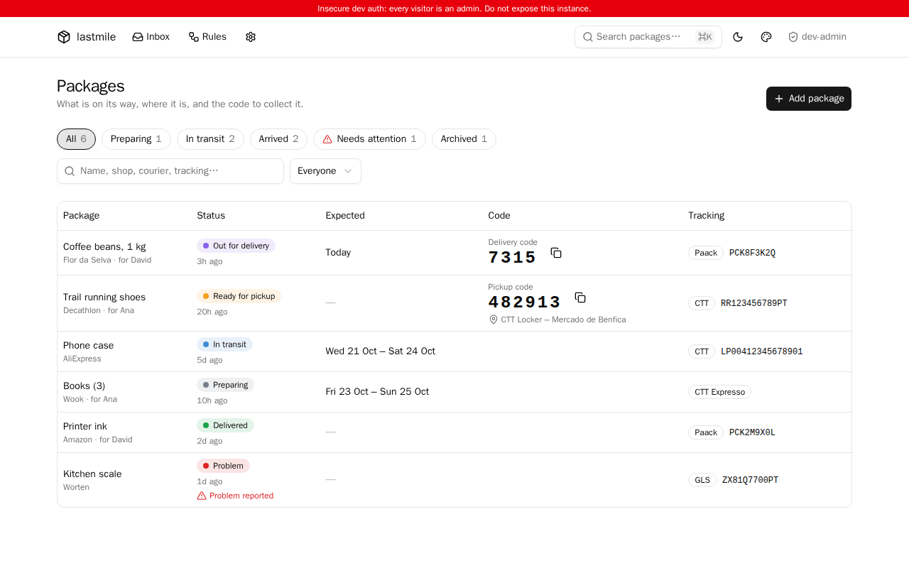
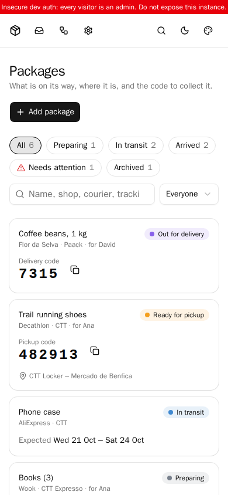
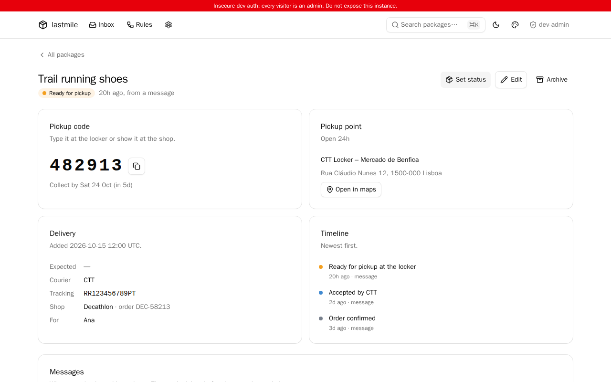
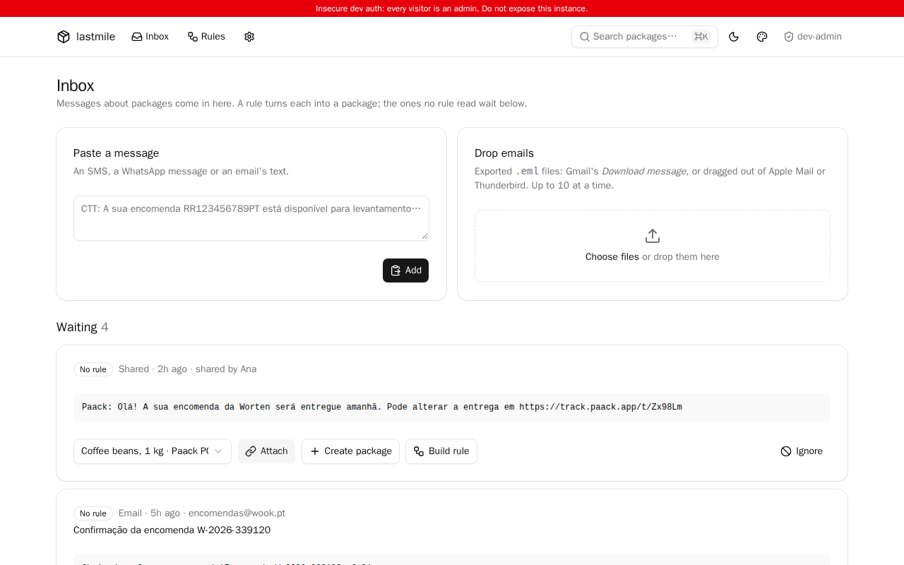
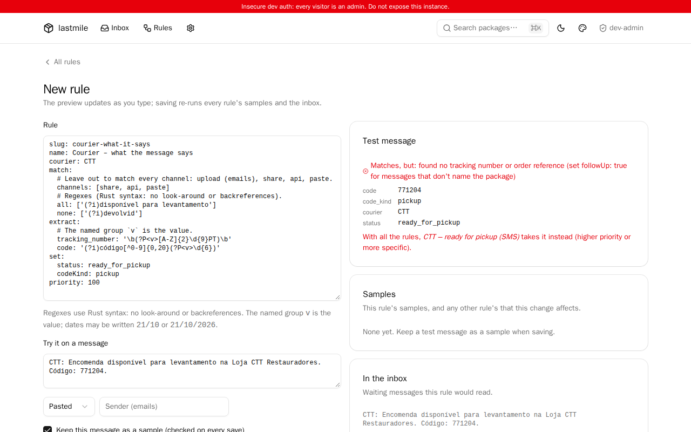

# lastmile

A self-hosted list of the packages a household is expecting: who is
delivering each one, where it is, and the code to give the courier or the
locker. A proof of concept for a homelab; see [docs/PLAN.md](docs/PLAN.md) for
where it is going.



| On a phone | A package ready for pickup |
|---|---|
|  |  |

| The inbox | A rule, built from a message |
|---|---|
|  |  |

## Status

**M2 – Messages and rules.** Couriers' and shops' messages come in, and
rules turn them into packages:

- **Channels.** A paste box and an `.eml` dropbox on the inbox page; the
  Android share sheet (lastmile installs as a PWA share target); an iOS
  Shortcut posting to `/api/ingest` with a per-person token
  ([docs/ios-shortcut.md](docs/ios-shortcut.md)).
- **Rules** are data, not code: match conditions (channel, sender, regexes),
  regexes that extract fields (tracking number, code, pickup point, dates…)
  and the status to set. None ship with the app: admins write them in an
  editor with a live preview, starting from an inbox message. Each rule keeps
  regression samples; saving re-runs every rule's samples and refuses a change
  that breaks one unless confirmed, then re-runs the inbox.
- **Packages** are found by tracking number (or order reference) and
  updated, or created. Status only moves forward from messages (manual changes
  always apply), and older news only goes on the timeline.
- **The inbox** keeps what no rule read, what a rule failed on, and
  follow-ups that don't say which package: attach them, create a package,
  build a rule or ignore them.
- **Retention.** Delivered packages are archived after `--archive-after`
  (7d), and message text is deleted after `--message-retention` (30d).

Before that, **M1** made the app useful by hand (add and edit packages, the
code in large print, filters, a timeline, status overrides, metrics), on
**M0**'s stack shared with [dominium](https://github.com/PedDavid/dominium)
and [clavium](https://github.com/PedDavid/clavium) (Rust, axum, askama,
Tailwind v4, Basecoat, htmx, OIDC) and SQLite.

Next (M3): redaction, drafting rules with an LLM, and sharing rules as text
or files.

## Running it

```sh
make demo   # sample packages in an in-memory database, no login
```

`--demo` loads made-up packages into a temporary in-memory database and, unless
OIDC is configured, lets every visitor in as an admin.

For real use, the app needs a writable directory for its database and an OIDC
provider:

```sh
lastmile \
  --database /data/lastmile.db \
  --public-url https://parcels.example.com \
  --oidc-issuer https://auth.example.com/application/o/lastmile/ \
  --oidc-client-id lastmile \
  --cookie-key-file /etc/lastmile/cookie-key
```

Every flag can also be set with a `LASTMILE_*` environment variable
(`lastmile --help` lists them). The UI listens on `:8080`; `/metrics`,
`/healthz` and `/readyz` on `:9090`, without authentication, so that port
should stay inside the cluster. `/api/ingest` is the only UI-port endpoint that
works without a login (it takes a token), and the phones need to reach it.

## Metrics

Computed from the database on every scrape.

| Metric | |
|---|---|
| `lastmile_packages{status, courier}` | Active (non-archived) packages; every status is exported, at 0 when empty |
| `lastmile_package_ready_since_timestamp_seconds{id, courier}` | When each package waiting at a pickup point got there |
| `lastmile_package_code_expiry_timestamp_seconds{id}` | When its pickup period ends, if known |
| `lastmile_inbox_messages{result}` | Messages waiting in the inbox: `unmatched`, `error`, or `matched` follow-ups to attach |
| `lastmile_messages_total{channel, result}` | Messages received |
| `lastmile_rules{origin, enabled}` | |

## Kubernetes

The Helm chart in `deploy/helm/lastmile` runs one replica (strategy
`Recreate`) with the database on a `ReadWriteOnce` PVC mounted at `/data`. The
PVC is kept on `helm uninstall`; back it up with the rest of your volumes. Set
`serviceMonitor.enabled` to have the Prometheus Operator scrape it.

```sh
helm install lastmile deploy/helm/lastmile \
  --set publicUrl=https://parcels.example.com \
  --set oidc.issuer=https://auth.example.com/application/o/lastmile/
```

## Development

```sh
make check        # fmt, clippy, tests (what CI runs)
make css          # rebuild assets/dist/app.css (Tailwind standalone CLI)
make helm-lint    # needs helm and yq
make visual-docker         # screenshot tests, in CI's container
make visual-docker-update  # rewrite the baselines in tests/screenshots/
```

The rule engine is tested with **synthetic** messages in the style of CTT
and Paack (`tests/fixtures/messages/`, each with an `*.expected.json`) and the
example rules in `tests/fixtures/rules/`; `--demo` loads the same rules and
messages. No real personal data is committed.

**Screenshots** (`tests/visual.rs`,
[playwright-rs](https://github.com/padamson/playwright-rust)) drive Chromium
against the `--demo` router in-process, with the clock pinned
(`demo_app` in `tests/common/mod.rs`), and compare with
`tests/screenshots/*.png`. Fonts and antialiasing differ between machines, so
they run in the same container image locally (`make visual-docker`) and on CI
(the `visual` job): `mcr.microsoft.com/playwright`, at the Playwright version
playwright-rs drives, with its browsers and fonts. Baselines rendered on any
machine with Docker match CI. On a failure, each `-actual.png` is kept next to its
baseline and CI uploads them as the `screenshots` artifact.
