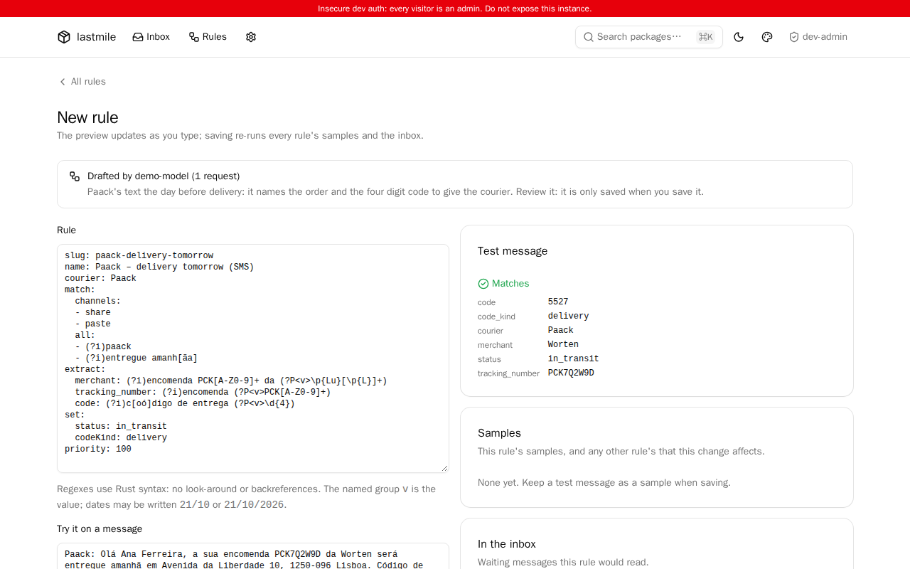

# lastmile

A self-hosted list of the packages a household is expecting: who is
delivering each one, where it is, and the code to give the courier or the
locker. A proof of concept for a homelab; see [docs/PLAN.md](docs/PLAN.md) for
where it is going.


| On a phone | A package ready for pickup |
|---|---|
|  |  |

| The inbox | A rule drafted by a model, to review |
|---|---|
|  |  |

## Status

**M3 – Rules with a model, and sharing.** On top of M2 (messages in, rules
turn them into packages):

- **Draft a rule with a model.** From an inbox message, an admin can ask a model
  to write the rule. Anything that goes out is **redacted** first: your
  household's names, addresses, phone numbers and emails (*Settings →
  Household*) and anything with a personal format (emails, phones, postcodes,
  NIFs, IBANs, cards, URL tokens, greetings) become placeholders like
  `‹NAME_1›`. The admin sees the original next to the redacted text, edits it,
  and nothing is sent until they click *Send*. A last check refuses any request
  that still contains a household value. The draft is then validated locally
  (it compiles, matches the message, and doesn't change other rules' samples),
  sent back to the model with the problems up to three times, and opened in the
  editor to review. See [docs/llm.md](docs/llm.md).
- **Any OpenAI-compatible model**: OpenAI (Chat Completions or the Responses
  API) or a self-hosted server (Ollama, vLLM, llama.cpp, LM Studio), through
  `--llm-model` and `--llm-base-url`.
- **Optionally, a Presidio analyzer** (`--presidio-url`, or `presidio.enabled`
  in the chart) finds names and places the household list doesn't have, in the
  same placeholders.
- **Optionally, packages are checked with CTT** by reading its tracking page in
  a headless Chromium (`--browser-url`, or `browser.enabled` in the chart). It
  is experimental; see [docs/couriers.md](docs/couriers.md).
- **Samples are stored redacted** (unless you choose to keep the original).
- **Share rules** as a `rule/v1` document: copy the YAML, a one-line blob for
  chat apps, or download a `.lastmile.yaml`. Samples leave only redacted.
  **Import** from a paste or a file, with a preview (what it reads, how its
  samples fare, which inbox messages it would take, a diff if it updates a rule
  you have). Imported rules are untrusted data, bounded like any rule, and saved
  **disabled**.

Before that: **M2** (paste box, `.eml` dropbox, Android share target, iOS
Shortcut API, rules, inbox), **M1** (add and edit by hand, filters, timeline,
metrics) and **M0** (the stack shared with
[dominium](https://github.com/PedDavid/dominium) and
[clavium](https://github.com/PedDavid/clavium)).

## Running it

```sh
make demo   # sample packages in an in-memory database, no login
```

`--demo` loads made-up packages into a temporary in-memory database and, unless
OIDC is configured, lets every visitor in as an admin.

For real use, the app needs a writable directory for its database and an OIDC
provider:

```sh
lastmile \
  --database /data/lastmile.db \
  --public-url https://parcels.example.com \
  --oidc-issuer https://auth.example.com/application/o/lastmile/ \
  --oidc-client-id lastmile \
  --cookie-key-file /etc/lastmile/cookie-key
```

Every flag can also be set with a `LASTMILE_*` environment variable
(`lastmile --help` lists them). The UI listens on `:8080`; `/metrics`,
`/healthz` and `/readyz` on `:9090`, without authentication, so that port
should stay inside the cluster. `/api/ingest` is the only UI-port endpoint that
works without a login (it takes a token), and the phones need to reach it.

## Metrics

Computed from the database on every scrape.

| Metric | |
|---|---|
| `lastmile_packages{status, courier}` | Active (non-archived) packages; every status is exported, at 0 when empty |
| `lastmile_package_ready_since_timestamp_seconds{id, courier}` | When each package waiting at a pickup point got there |
| `lastmile_package_code_expiry_timestamp_seconds{id}` | When its pickup period ends, if known |
| `lastmile_inbox_messages{result}` | Messages waiting in the inbox: `unmatched`, `error`, or `matched` follow-ups to attach |
| `lastmile_messages_total{channel, result}` | Messages received |
| `lastmile_rules{origin, enabled}` | |
| `lastmile_llm_requests_total{result}`, `lastmile_llm_tokens_total{kind}` | Requests to and tokens used by the model that drafts rules |
| `lastmile_analyzer_requests_total{result}` | Requests to the analyzer that suggests what to redact |
| `lastmile_courier_checks_total{courier,result}` | Packages checked with a courier's tracking page (`ok`, `empty`, `error`) |

## Kubernetes

The Helm chart in `deploy/helm/lastmile` runs one replica (strategy
`Recreate`) with the database on a `ReadWriteOnce` PVC mounted at `/data`. The
PVC is kept on `helm uninstall`; back it up with the rest of your volumes. Set
`serviceMonitor.enabled` to have the Prometheus Operator scrape it.

```sh
helm install lastmile deploy/helm/lastmile \
  --set publicUrl=https://parcels.example.com \
  --set oidc.issuer=https://auth.example.com/application/o/lastmile/
```

## Development

```sh
make check        # fmt, clippy, tests (what CI runs)
make css          # rebuild assets/dist/app.css (Tailwind standalone CLI)
make helm-lint    # needs helm and yq
make visual-docker         # screenshot tests, in CI's container
make visual-docker-update  # rewrite the baselines in tests/screenshots/
```

The rule engine is tested with **synthetic** messages in the style of CTT
and Paack (`tests/fixtures/messages/`, each with an `*.expected.json`) and the
example rules in `tests/fixtures/rules/`; `--demo` loads the same rules and
messages. No real personal data is committed.

**Screenshots** (`tests/visual.rs`,
[playwright-rs](https://github.com/padamson/playwright-rust)) drive Chromium
against the `--demo` router in-process, with the clock pinned
(`demo_app` in `tests/common/mod.rs`), and compare with
`tests/screenshots/*.png`. Fonts and antialiasing differ between machines, so
they run in the same container image locally (`make visual-docker`) and on CI
(the `visual` job): `mcr.microsoft.com/playwright`, at the Playwright version
playwright-rs drives, with its browsers and fonts. Baselines rendered on any
machine with Docker match CI. On a failure, each `-actual.png` is kept next to its
baseline and CI uploads them as the `screenshots` artifact.
