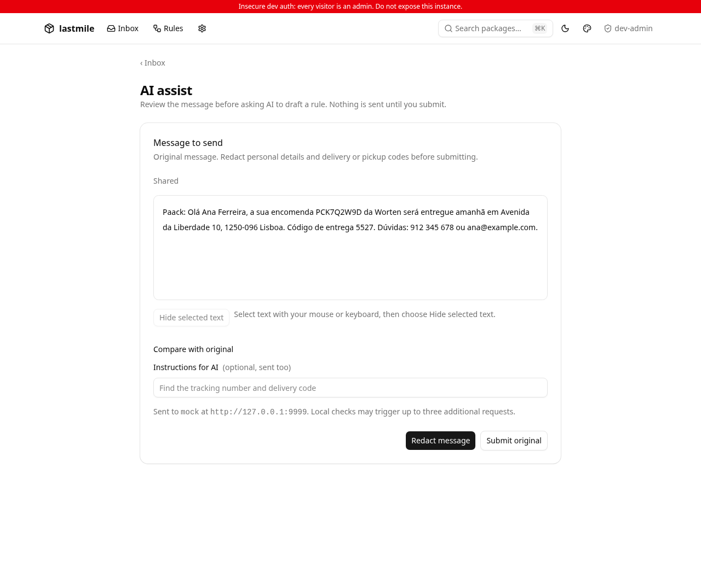
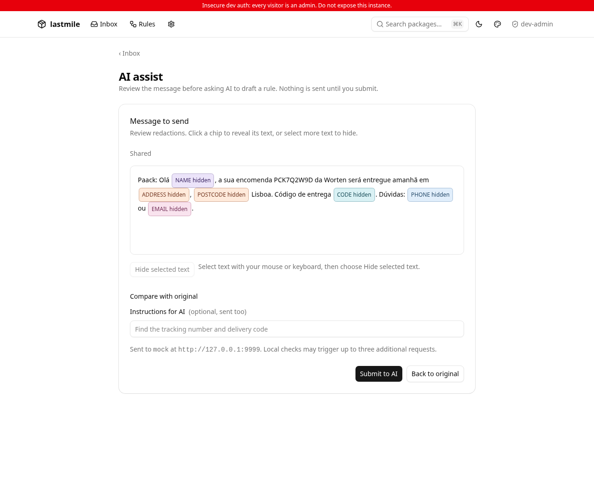
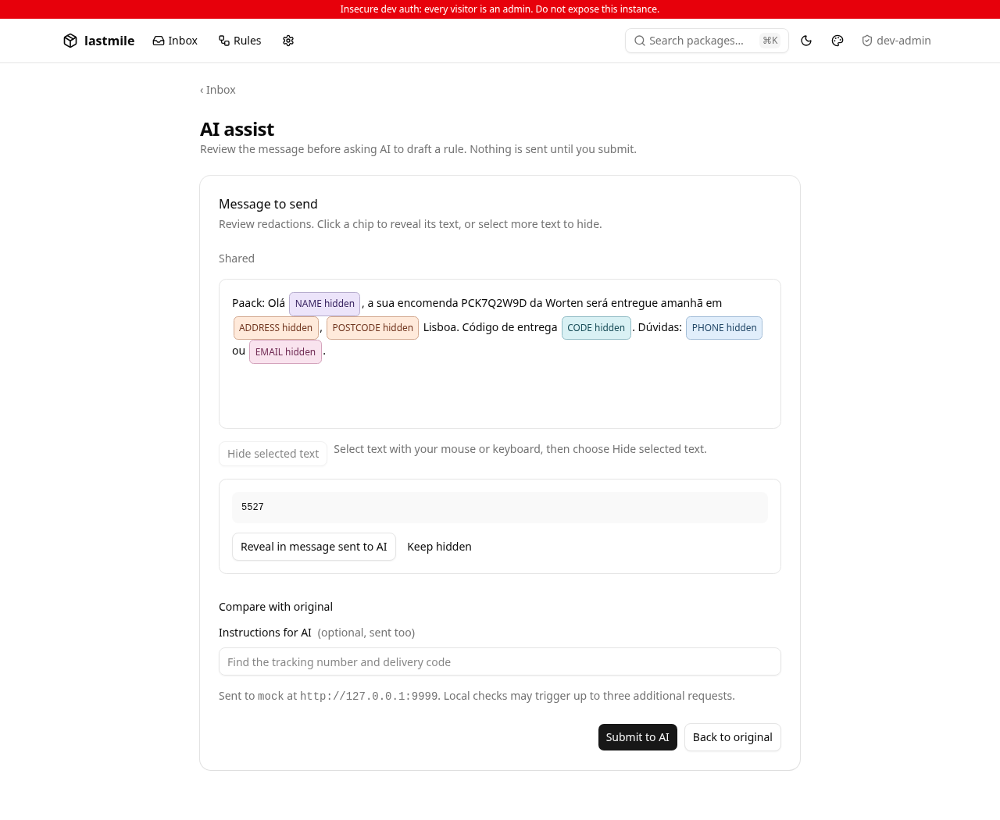
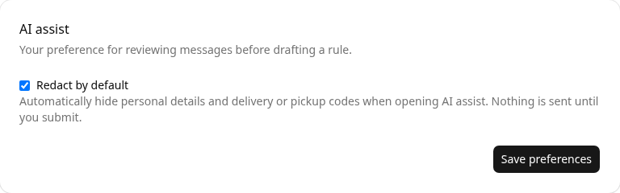

## Screenshots

Captured from the running app using synthetic demo data. These are review screenshots, separate from the pinned visual-test baselines.

### Original message — Redact message is primary

### Redacted message — Submit to AI is primary

### Inspect and reveal a delivery code

### Per-user Redact by default preference

